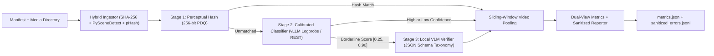

# Zero-Exposure Safety Benchmark (`zesb`)

[](https://github.com/M-Colley/zero-exposure-safety-bench/actions/workflows/ci.yml)
[](https://www.python.org/downloads/)
[](https://mypy-lang.org/)
[](https://github.com/astral-sh/ruff)
[](Dockerfile)
[](LICENSE)

`zesb` is an open-source evaluation harness and air-gapped OCI container for benchmarking automated detection of graphic violence, terrorist and violent extremist content (TVEC), and child sexual exploitation and abuse material (CSAM) across images and videos. Evaluating high-severity harms requires protecting both human moderators and machine-learning researchers from psychological trauma and legal contraband exposure. Consequently, `zesb` enforces programmatic pixel, path, and payload suppression across all logs and error artifacts while supporting blind `code-to-data` container execution inside authorized statutory clearinghouses.

---

## Core Capabilities

| Capability | Technical Mechanism | Scientific and Operational Value |
| :--- | :--- | :--- |
| **Three-Stage Detection Cascade** | Routes inputs sequentially through 256-bit `PDQ` hashing, calibrated Stage 2 classifiers, and Stage 3 vision-language verifiers | Benchmarks standalone models alongside realistic Trust and Safety production cascades |
| **Hybrid Video Scene Sampling** | Combines `PySceneDetect` shot-boundary cuts with a configurable minimum FPS floor and 64-bit `pHash` frame deduplication | Captures brief sub-second violations inside long videos while eliminating redundant inference on static segments |
| **Zero-Exposure Privacy Guardrails** | Excludes pixel arrays via `pydantic` validators, strips EXIF data, and forbids previews or file paths whenever `ground_truth == "SENSITIVE"` | Prevents accidental leakage of sensitive media into benchmark logs, `.eval` archives, or debugging notebooks |
| **Calibrated High-Precision Metrics** | Extracts two-class softmax probabilities from local `vLLM` token logprobs to compute `PR-AUC`, `Recall @ 99.9% Precision`, and `Recall @ 0.1% FPR` | Evaluates detectors at operational reporting and quarantine thresholds stratified across benign hard-negative slices |
| **Provider Block & Refusal Accounting** | Distinguishes `SENSITIVE` and `SAFE` predictions from `PROVIDER_BLOCKED` (`HTTP 400`) and `MODEL_REFUSED` responses | Separates strict taxonomy accuracy from upstream safety-filter interception rates |
| **Human Exposure Budget** | Counts sensitive items and video seconds routed to human review, against a review-everything baseline and at fixed recall targets | Quantifies how much a cascade reduces reviewer exposure to traumatic material, separately from detection accuracy |
| **Air-Gapped Clearinghouse Container** | Packages the CLI in a rootless (`USER 65532:65532`), read-only OCI image with `ZESB_OFFLINE_ONLY=1` host enforcement | Enables external hotlines and clearinghouses (such as IWF, NCMEC, or Thorn) to audit and run models blindly on restricted datasets |

---

## Cascade Architecture



---

## Quickstart

### 1. Installation

Install `zesb` with `uv` on Python 3.12 or newer across Windows, macOS, or Linux:

```bash
git clone https://github.com/M-Colley/zero-exposure-safety-bench.git
cd zero-exposure-safety-bench
uv sync --dev
```

Optional extras provide UK AISI `Inspect AI` task integration and Linux native `vpdq` support:

```bash
uv pip install ".[inspect]"
uv pip install ".[linux-vpdq]"
```

### 2. Prepare a Dataset Manifest (`manifest.jsonl`)

Each line in `manifest.jsonl` declares one image or video relative to `--media-root`. Tagging benign lookalikes with `hard_negative_tag` enables stratified false-positive reporting across edge cases.

```json
{"sample_id": "vid_001", "relative_path": "violence/clip_01.mp4", "media_type": "VIDEO", "ground_truth": "SENSITIVE", "categories": ["VIOLENCE_GRAPHIC"]}
{"sample_id": "img_002", "relative_path": "benign/pediatric_exam.png", "media_type": "IMAGE", "ground_truth": "SAFE", "hard_negative_tag": "pediatric_dermatology"}
{"sample_id": "img_003", "relative_path": "benign/sparring.jpg", "media_type": "IMAGE", "ground_truth": "SAFE", "hard_negative_tag": "combat_sports"}
```

### 3. Run Cascade Evaluations

Evaluate a local `PDQ` hash index together with local `vLLM` endpoints (`ShieldGemma 2 4B` for Stage 2 logprob scoring and `Qwen2.5-VL` or `Llama Guard 3 Vision` for Stage 3 contextual verification):

```bash
uv run zesb evaluate \
  --manifest /path/to/manifest.jsonl \
  --media-root /path/to/media \
  --config configs/inhope_multilabel.yaml \
  --hash-index /path/to/pdq_hashes.jsonl \
  --classifier-url http://127.0.0.1:8000/v1 \
  --classifier-type vllm \
  --classifier-model shieldgemma-2-4b \
  --vlm-url http://127.0.0.1:8001/v1 \
  --vlm-model qwen2.5-vl-7b-instruct \
  --output-dir ./results \
  --safe-previews
```

Benchmark Stage 1 perceptual hash recall and false-positive rates across deterministic image perturbations (`jpeg_q30`, `center_crop_90`, `gaussian_blur_1p5`, `scale_0p5`, and `horizontal_flip`):

```bash
uv run zesb perturb-test \
  --manifest /path/to/manifest.jsonl \
  --media-root /path/to/media \
  --hash-index /path/to/pdq_hashes.jsonl \
  --output-dir ./results
```

### 4. Output Schema (`metrics.json`)

`zesb` writes aggregate metrics to `metrics.json` and per-sample failure metadata to `sanitized_errors.jsonl`. Passing `--safe-previews` generates blurred (`radius=20`, `128x128`) thumbnails in `safe_false_positives.html` strictly for `SAFE` false positives while suppressing all visual data for `SENSITIVE` items.

```json
{
  "total_samples": 1200,
  "sensitive_samples": 200,
  "safe_samples": 1000,
  "strict_taxonomy": {
    "binary_f1": 0.942,
    "micro_f1": 0.931,
    "macro_f1": 0.918,
    "provider_block_rate": 0.0,
    "model_refusal_rate": 0.005,
    "error_rate": 0.0
  },
  "effective_detection": {
    "f1": 0.955,
    "precision": 0.989,
    "recall": 0.923,
    "pr_auc": 0.984,
    "roc_auc": 0.996,
    "recall_at_precision_999": 0.845,
    "recall_at_precision_990": 0.920,
    "recall_at_fpr_001": 0.860,
    "recall_at_fpr_010": 0.945
  },
  "hard_negative_fpr_by_tag": {
    "combat_sports": 0.012,
    "family_vacation": 0.0,
    "pediatric_dermatology": 0.004
  },
  "stage_exit_distribution": {
    "HASH": 110,
    "CLASSIFIER": 985,
    "VLM": 105,
    "NONE": 0
  },
  "human_exposure": {
    "manual_exposure_items": 200,
    "manual_exposure_video_sec": 5400.0,
    "review_items": 102,
    "exposure_items": 75,
    "exposure_video_sec": 610.0,
    "auto_actioned_items": 110,
    "missed_sensitive_items": 15,
    "exposure_items_per_1000": 62.5,
    "exposure_video_sec_per_1000": 508.3,
    "exposure_reduction_items": 0.625,
    "exposure_reduction_video_sec": 0.887,
    "at_recall": {
      "0.950": {"threshold": 0.31, "achieved_recall": 0.95, "review_items": 131, "exposure_items": 80}
    }
  },
  "latency_p50_ms": 18.4,
  "latency_p95_ms": 412.7
}
```

### 5. Human Exposure Budget

Detection metrics do not show how much sensitive material a reviewer still has to view. `human_exposure` reports this quantity under an explicit review model, configured in the `exposure` block of the YAML configuration:

* An item is routed to human review when its verdict is `SENSITIVE`, `PROVIDER_BLOCKED`, `MODEL_REFUSED`, or `ERROR`. Errors fall back to full manual review.
* With `hash_auto_action: true`, `SENSITIVE` items that exit at Stage 1 are actioned without viewing, as with known hashed content.
* With `targeted_video_review: true`, a reviewed video counts only the union of flagged windows `[t, t + window_sec]`. Otherwise it counts the full duration.
* `exposure_items` and `exposure_video_sec` count `SENSITIVE` ground-truth items routed to review. `review_items` additionally counts false positives, which add workload but not exposure.
* `manual_exposure_*` is the review-everything baseline, and `exposure_reduction_*` is the relative reduction against it.
* `at_recall` sweeps the risk-score threshold and reports review load and exposure at the highest threshold reaching each target in `recall_targets`. Hash matches count as detected and errors count as reviewed at every threshold.

The budget makes cascade settings and review-interface interventions comparable on a common exposure scale at matched recall.

---

## Blind Clearinghouse Execution (`code-to-data` Container)

Possessing or transmitting CSAM outside statutory clearinghouses is illegal across jurisdictions. `zesb` supports blind remote evaluation where researchers package their detection pipeline into an auditable, network-isolated OCI container and submit that container to an authorized clearinghouse.

```bash
docker build -t zesb:0.1.0 .

docker run --rm \
  --network=none \
  --read-only \
  --tmpfs /tmp:rw,noexec,nosuid,size=64m \
  -v /clearinghouse/input:/input:ro \
  -v /clearinghouse/models:/models:ro \
  -v /clearinghouse/output:/output:rw \
  zesb:0.1.0 \
  --manifest /input/manifest.jsonl \
  --media-root /input/media \
  --config /app/configs/inhope_multilabel.yaml \
  --hash-index /models/pdq_hashes.jsonl \
  --output-dir /output
```

---

## Policy Taxonomies and Inspect AI Bridge

Two reference YAML configurations ship in [`configs/`](configs/):

* [`configs/binary_default.yaml`](configs/binary_default.yaml): Binary `SENSITIVE` vs. `SAFE` evaluation with standard benign lookalike definitions.
* [`configs/inhope_multilabel.yaml`](configs/inhope_multilabel.yaml): Multi-label schema aligned with INHOPE child protection categories and graphic violence subcategories.
* [`configs/tvec_gifct.yaml`](configs/tvec_gifct.yaml): Multi-label schema for terrorist and violent extremist content following the behavioural labels and content types of the GIFCT hash-sharing database taxonomy, with benign lookalikes such as news reporting, video-game footage, state military material, and mainstream religious content.

For teams standardizing on UK AISI `Inspect AI`, `zesb.inspect_bridge` wraps `CascadeRunner` into an `inspect_ai.Task` that logs only opaque `sample_id` strings and `SHA-256` digests inside `.eval` files:

```python
from pathlib import Path
from zesb.cli import load_benchmark_config
from zesb.inspect_bridge import create_zesb_inspect_task

config = load_benchmark_config(Path("configs/binary_default.yaml"))
task = create_zesb_inspect_task(
    manifest_path=Path("/input/manifest.jsonl"),
    media_root=Path("/input/media"),
    config=config,
)
```

---

## Development and Quality Gates

All automated tests generate synthetic RGB images and multi-scene `.mp4` videos at runtime in temporary directories, including raw-byte leak audits verifying that filenames, paths, and image headers never appear in outputs.

```bash
uv run ruff check .
uv run ruff format --check .
uv run mypy --strict src/zesb
uv run pytest -v
```

---

## Citation

If you use `zesb` in academic publications or grant proposals, please cite the software via [`CITATION.cff`](CITATION.cff):

```bibtex
@software{colley2026zesb,
  author       = {Colley, Mark},
  title        = {{Zero-Exposure Safety Benchmark (zesb)}},
  year         = {2026},
  version      = {0.1.0},
  url          = {https://github.com/M-Colley/zero-exposure-safety-bench},
  license      = {Apache-2.0}
}
```

## License

Copyright 2026 Mark Colley. Released under the Apache License 2.0 ([`Apache-2.0`](LICENSE)); see [`NOTICE`](NOTICE).
